# Bitácora completa — Atlas Pluriversal

> **Cobertura:** 2024 → 2026-10-19, con evidencia visual al **2026-10-24** (Parte V).
> **Método:** documentos históricos + `docs/BITACORA.md` + `git log` del repositorio actual
> + repositorio espejo `atlas-preview`.
> **Regla:** las fechas se reproducen como fueron registradas. Donde no hay evidencia se
> escribe **«sin registro»**; no se inventan actividades.
>
> Este documento complementa —no reemplaza— `docs/BITACORA.md`. La bitácora original cubre
> con detalle hasta **2026-09-06**; aquí se resume esa etapa y se reconstruye **2026-09-07 →
> 2026-10-19** desde los commits.

---

## Parte I — Origen y prototipo (2024 – 2025)

### 1.1 Contexto

El Atlas Pluriversal es una cartografía digital del **Valle Alto del Río Cauca**, desarrollada
en el marco de la Universidad Mayor de Colombia. El objetivo editorial es contar el territorio
desde el agua: cuatro capítulos, mapas georreferenciados, textos comunitarios, fotografías,
audio y puntos de interés.

La documentación de esta etapa (`PROYECTO_ATLAS_DOCUMENTACION_COMPLETA.md`, 902 líneas)
organiza el proyecto en 13 secciones: descripción, objetivos, metodología, equipo,
tecnologías, funcionalidades, estructura, desarrollo, cronología, aspectos técnicos, impacto,
trabajo futuro y créditos.

### 1.2 Fase 1 — Prototipo Leaflet (2024 – 2025)

- Motor: **Leaflet**, no MapLibre. Los mapas se montan como imágenes y capas.
- Navegación por capítulos en construcción.
- Se consolidan los contenidos base: mapas del valle, perfiles, talleres, organizaciones.
- No hay registro diario ni repositorio git local en el workspace actual. La historia de esta
  fase es **por periodo**, no por día.

### 1.3 Fase 2 — Atlas 1.5.0 (2025)

`ATLAS_ESTADO_ACTUAL_DESARROLLO.md` (agosto de 2025) reporta el estado:

| Componente | Avance |
|---|---|
| Mapas Leaflet | 100 % |
| Carrusel de perfil y talleres | 100 % |
| Navegación | 95 % |
| Modales | 100 % |
| Avance global | 75 % (Fase 2) |

Esta es la **última versión del prototipo** y la base editorial que hereda el proyecto actual.

### 1.4 Cierre del prototipo y correcciones (2025-12)

- **2025-12-22** — Se corrige el `z-index` de los tooltips de topónimos. El popup de MapLibre
  se elevaba por debajo de otros elementos; la solución busca `.maplibregl-popup` con
  `closest()` y aplica `z-index: 10000` al entrar, limpiándolo al salir. Archivo registrado:
  `src/components/MapController/agregarToponimos.jsx`.
- Quedan pendientes de contenido y UI registrados en `Gestion_Proyecto/Lista_de_Tareas.md`:
  capas truncadas («Cali se deseca»), flecha redundante, desfase del mosaico de cuencas frente
  al GeoJSON, correspondencia números/textos de cuencas, capa «Transformaciones sin
  información», indicador de punto de vista, flechas de perfiles del capítulo 1, título del
  último perfil del capítulo 1 y convenciones del panel de capas.

**Lección heredada:** el prototipo resolvía la navegación y el contenido, pero no la
georreferenciación fina ni el rendimiento en hardware modesto. Esos dos problemas definen la
etapa siguiente.

---

## Parte II — Investigación y reescritura (2026-02 → 2026-08-05)

### 2.1 Línea de tiempo registrada

| Fecha | Hecho | Evidencia |
|---|---|---|
| 2026-02-21 | Investigación de rotación sincronizada entre imagen base y tiles de MapLibre. | `INVESTIGACION_ROTACION_TILES_MAPLIBRE.md` |
| 2026-04-13 | Interacciones 1–14: georreferenciación, bounds en runtime, validación cuantitativa. | bitácora de 3.0 |
| 2026-04-14 | Interacciones 15–16: `viewportMaxBounds` con zoom; el clamp bearing-aware se descarta. | bitácora de 3.0 |
| 2026-04-15 | Interacción 17: se elige `setTransformConstrain`. | bitácora de 3.0 |
| 2026-05-16 | Interacciones 18–26: migración de `v17` a 3.0 (PGW, bounds, constrain, zoom). | bitácora de 3.0 |
| 2026-06-26 | Interacciones 27–30: dimensiones reales de Cloudinary; calibración definitiva del capítulo 1. | bitácora de 3.0 |
| 2026-07-03 | Interacciones 31–33: PGW de subcapas raster, popup y calibración de `unRioCauca`. | bitácora de 3.0 |
| 2026-07-15 | Interacción 34: conversión masiva de PGW de capítulos 2–4; 31 mapas configurados. | bitácora de 3.0 |
| 2026-07-30 | Investigación profunda de rotación en los tres proyectos. | `docs/BITACORA.md` |
| 2026-08-04 | Rotación −30° en `chapter4-problematicas`; panel compatible con PGW rotado; fix de URLs 404 de `chapter2-m-villa-rica`. | `docs/BITACORA.md` |
| 2026-08-05 | Fix de `chapter2-m-suarez`; organización de originales por capítulo; piloto de tiles del capítulo 1; plan de faceta 2; diagnóstico de doble build; z12 + Service Worker + `lowPowerMode`. | `docs/BITACORA.md` |

### 2.2 Qué se aprendió en esta etapa

1. **El PGW rotado es la fuente de verdad.** El prototipo y `v17` guardaban PGW ya convertido
   a formato estándar. La conversión introducía errores. El proyecto actual conserva el PGW
   rotado original y deja que MapLibre rote el viewport con `bearing: -90`.
2. **`setMaxBounds` no sirve con bearing −90°.** MapLibre clampea longitud contra el ancho y
   latitud contra el alto; al rotar el viewport los ejes se intercambian. La solución es
   `setTransformConstrain`, que se ejecuta antes de cada render.
3. **La rotación no se resuelve rotando archivos.** Rotar imágenes en el pipeline exigía GDAL
   y rompía la correspondencia con los tiles. Se rota la cámara, no el asset.
4. **El contenido es el activo más caro.** Los textos, galerías, íconos y audios de `v17` se
   migran; el código no. La reescritura reutiliza datos, no implementaciones.
5. **El rendimiento es un requisito de audiencia.** El usuario final no es un equipo de
   desarrollo: es una sala comunal con PC de gama baja y conectividad rural.

### 2.3 Nacimiento del proyecto actual

- **2026-08-06** — Primer commit del repositorio `atlas-pluriversal`
  (`d303d7d`, «chore: configuración inicial del proyecto»). Ese día se crean la base Vite, los
  servicios de georreferenciación, los 31 mapas con PGW, los stores Zustand, los componentes
  de mapa, las páginas de test, los assets y la documentación inicial.
- **2026-08-26** — Se publica el espejo histórico `sjmontano/atlas-preview` (commit único
  `9b4d127`). Se usa como referencia del prototipo; no participa del runtime.

---

## Parte III — Bitácora diaria del repositorio actual (2026-08-06 → 2026-10-19)

**Totales verificados:** 238 commits (`--all`), 228 en `main`.
Agosto: 83 · Septiembre: 107 · Octubre: 48.

### 2026-08-06 · 8 commits — Base del proyecto

- `d303d7d` configuración inicial.
- `3ca903b` servicios core de georreferenciación y calibración.
- `ef03ffe` datos geográficos: 31 mapas con PGW, Cloudinary y configuración de tiles.
- `f09e99c` stores Zustand y hook `useMap`.
- `64553ce` componentes de mapa: `AtlasMap`, `MapControls`, `CalibrationPanel`.
- `8e859b1` páginas de test, entrada React 19 + `StrictMode`, estilos globales.
- `8f6990f` assets públicos y herramientas de build.
- `a6d66a2` documentación completa e historial de commits.

**Decisión del día:** se reconstruye como aplicación nueva, no como migración de código.
Se conservan datos, contenidos y assets.

### 2026-08-07 y 2026-08-08 — Sin registro

No hay commits ni entradas de bitácora para estos días.

### 2026-08-09 · 5 commits — Diagnóstico rural

- `8a2122e` mapa funcional y mejoras rurales: worker de MapLibre v6, fix de altura, baja
  conectividad y rendimiento.
- `0f1d3fd` caché adaptativo de tiles, prefetch z6–z8 y corrección del banner degradado.
- `b8395c7` precarga de la ruta de mapa y reutilización de imágenes ya cargadas.
- `84759f6` los tiles no esperan a la imagen full; el prefetch espera el fin de carga.
- `707ec14` corrección de cuatro hallazgos de red: doble carga de imagen full, placeholder
  pesado y tiles duplicados.

**Episodio: pantalla azul sin error.**
El síntoma era un canvas azul (`#03091e`) sin mapa y sin error en consola. La causa fue el
doble montaje de `StrictMode`: dos builds competían y el segundo destruía el primero. Se
resolvió con un contador de generación (`buildGen`) en `useMap`, que invalida el build viejo.
En paralelo se corrigió la cadena de altura CSS: `.mapArea { min-height: 0 }` y
`.wrapper { flex: 1; min-height: 0 }`; nunca `height: 100%` en cadena.

**Episodio: worker de MapLibre v6 con Vite.**
El import `?worker&url` rompía el canal del worker en desarrollo. Se vendorizó el worker en
`public/vendor/maplibre/`, se registra con `setWorkerUrl` en `main.tsx` y se sincroniza con
`pnpm sync:maplibre`.

### 2026-08-10 · 10 commits — Sistema de capas

- `5be5599` tipos de capas y tipo `Poi`.
- `f2902cc` `layerStore` con selección de calibración, grupos y persistencia.
- `82b1920` datos de capas compartidas, grupos, por mapa, calibración y POI.
- `e815fbe` `LayerManager` con sincronización, alta y actualización de PGW.
- `8d4c4d2` `PoiManager` y `PoiModal`.
- `1bedce5` `LayerMenu` con árbol, grupos y modo de calibración.
- `86f860e` `CalibrationPanel` con selector de objetivo multicapa.
- `c889851` `rewriteLayerCalibration` y plugin Vite para guardar capas.
- `88dd993` integración de capas, POI y menú en `AtlasMap`.
- `03d65e4` limpieza de advertencias de lint.

**Decisión:** las capas se agrupan por tema y se calibran por separado del mapa base. La
calibración deja de ser un ajuste manual de archivo y pasa a un panel en vivo con persistencia
en desarrollo.

### 2026-08-11 · 14 commits — Calibración de capas y capítulo 1

- Se añaden siete capas interactivas para `chapter1-mosaicos-del-agua` y siete para
  `chapter1-un-rio-cauca`.
- La calibración pasa a doble modo: mapa base y capas, con lectura por capa.
- El arrastre mueve el origen de la capa, no los límites del mapa.
- Se georreferencian los composites de ecosistemas al *footprint* del mapa base.
- Se sincronizan capas y POI después de construir el mapa (dependencia `mapBuilt`).
- Se corrige `getBeforeId` para verificar que la capa de POI exista.
- Se mueve `LayerMenu` a la izquierda y se colapsan ambos paneles por defecto.
- Se añade un conmutador de visibilidad de tiles en los controles de desarrollo.

**Lección:** el orden de inserción de capas importa. Un `beforeId` que apunta a una capa
inexistente rompe el render; la sincronización debe ocurrir después del build.

### 2026-08-12 · 2 commits — POI de Bredunco

- Cuatro POI con tooltip al pasar el cursor y fuente Noto Sans.
- Recalibración de PGW y dimensiones de las capas de `chapter1-un-rio-cauca`.

### 2026-08-13 — Sin registro

### 2026-08-14 · 3 commits — Nodos del capítulo 2

- 33 POI de Formas del Paisaje, con tamaño grande y pulso animado.
- POI y capas de los nodos Suárez, Villa Rica y Oriente de Cali.
- Ajuste del tamaño de flechas y de la imagen interna.

### 2026-08-15 · 5 commits — TypeScript y reorganización de contenido

- Migración completa de `src/` a TypeScript puro (sin `.js` ni `.d.ts`).
- Reorganización de datos por capítulo y tema central de estilos.
- Capas raster activables y leyendas informativas en el capítulo 3.
- POI de la introducción del capítulo 4 y leyendas con íconos por finca.
- Se documenta la especificación de reorganización de contenido.

**Decisión:** se abandona la regla híbrida JS/TS del plan inicial. Todo el código es TS; los
datos de contenido viven en módulos tipados por mapa.

### 2026-08-16 · 6 commits — Viewport y correcciones

- Margen de viewport configurable por mapa y por eje (horizontal/vertical).
- Margen negativo para recortar el pan y constrain en ecosistemas.
- Margen por defecto 0 % (sin holgura).
- Corrección de imagen full del capítulo 4 con URL `medium` de Cloudinary.
- POI de la introducción del capítulo 4 con `popupNode.svg` compartido y flecha `#3D80A5`.

### 2026-08-17 · 12 commits — Tiles con techo de pantalla y assets

- `70823f7` utilidad `tileZoom`: techo de pantalla con redondeo a 256 y
  `constrainMinZoom` bearing-aware, con tests.
- `26bccf1` configuración central `MAP_TILE_MODES` para 31 mapas y fábrica
  `makeTilesConfig`, con tests.
- `882f685` se eliminan `minZoom`/`maxZoom` de `MapConfig`: ahora se derivan.
- `c16be5d` módulos de contenido con tiles derivados para 31 mapas.
- `57ebe19` `MapRenderer` con `minZoom: 0` y `maxZoom` derivado del techo real.
- `f74890d` generador reescrito: techo de pantalla, soporte local/AVIF, sin `aux.xml` y
  limpieza de zooms.
- Reorganización de assets: `assets/ui`, `assets/pois`, `assets/legends`, con nombres
  kebab-case y referencias actualizadas.

**Decisión:** el zoom máximo de un mapa no se elige a mano. Se calcula desde el tamaño de
pantalla y la resolución de la imagen, redondeando a potencias de 256. Esto evita generar
tiles que nunca se muestran y evita el *over-zoom*.

### 2026-08-18 — Verificación de tiles (sin commits)

Verificación en navegador de la faceta 2:

- `chapter1-ecosistemas`: **173 tiles** en z8–z10.
- `chapter1-encuadres`: **12 tiles** en z6.
- Alineación con la imagen base: diferencia media **35–42** y **menos del 1 %** de píxeles con
  diferencia mayor a 200.
- Se ajusta el `maxZoom`: ecosistemas de 25 a 10; encuadres a 6.

### 2026-08-19 · 5 commits — Limpieza y conexión lenta

- Detección de conexión lenta unificada en `connectionStore`.
- Prefetch sin doble adaptación de zoom; barrel completo de tema.
- Eliminación de artefactos obsoletos y assets de UI sin uso.
- `README.md` actualizado a la estructura actual.
- `pnpm-workspace.yaml` con `allowBuilds` de esbuild.

### 2026-08-20 · 3 commits — Entrega adaptativa

- `6d0458b` entrega adaptativa de tiles standard/HD, pirámide HD ligera y *anti-aliasing*
  nearest.
- `c2ec9f1` pirámide HD ligera global, `zoomMax` manual por mapa y vista desacoplada
  (*overzoom*).
- `b90e658` caché del Service Worker con poda de generaciones y tope de tamaño; cambio de
  perfil de tiles sin reconstruir el mapa.

**Decisión:** el perfil de tiles se cambia en caliente. Reconstruir el mapa para pasar de
standard a HD costaba segundos y perdía la posición de cámara.

### 2026-08-21 · 3 commits — Modales full-bleed

- Sistema de modales y UI de desarrollo.
- Layouts full-bleed, ícono en el título y decorador.
- Header unificado en `ModalShell` y ajuste del *scrim* en `InicioLayout`.

### 2026-08-22 — Sin registro

### 2026-08-23 · 3 commits — Home

- Reconstrucción de la página de inicio basada en `v17`: POI, mapa de introducción y panel de
  control.
- Corrección del fondo full-bleed en `InicioLayout`.
- Unificación de variantes de tamaño de modal y soporte de fondo full-bleed.

### 2026-08-24 a 2026-08-26 — Sin registro

### 2026-08-27 · 1 commit — Capítulo 1 completo

`7f243fb` cierra el capítulo 1: shell, modales, encuadres, capas y correcciones. Es el primer
capítulo navegable de punta a punta en la reconstrucción.

### 2026-08-28 · 1 commit — Layout de presentación

`1f5707f` añade el layout `feature`, el modal de presentación y corrige `bgImage` y cierre.

### 2026-08-29 y 2026-08-30 — Sin registro

### 2026-08-31 · 2 commits — Separación de estado

- `136dfb5` UI de mapas centralizada en `map.ts`; limpieza de la fase 1 de modales.
- `5a1cf32` `presentacion.ts` pura; `uiStore` se separa en `modalStore` y `mapUIStore`.

**Decisión:** el estado de interfaz se divide por dominio. Un solo `uiStore` mezclaba modal,
basemap, opacidad y perfil de tiles, y provocaba re-render en componentes que no lo usaban.

### 2026-09-01 · 1 commit — Reorganización de modales

`0346831` reorganiza modales por función y añade barra de scroll personalizada.

### 2026-09-02 · 15 commits — Sistema de modales por bloques

Día de pulido intensivo del modal de presentación:

- Unificación del sistema con bloques apilables.
- Estilo `v17`: carrusel con transición, indicadores de scroll y botón de enlace.
- Columnas flex, ajuste de `highlight` y `link`, tamaño exacto.
- Constantes CSS e inyección de estilos por modal.
- Correcciones de flechas, descriptores, `columnGap`, borde lateral del aside y altura fija
  del carrusel (38vh).
- Animaciones, responsive, gestos táctiles y navegación por teclado.
- Barra de scroll visible y `bodyMaxWidth` responsive.

**Lección:** el carrusel no debe expandirse con el contenido. Altura fija y descriptor con el
mismo ancho de la imagen evitan saltos de layout.

### 2026-09-03 · 12 commits — Auditoría y fábrica de mapas

- `d930e4b` auditoría general: cambios en todo el proyecto.
- `25c7972` fábrica `makeMap`; migración de 26 mapas.
- `b4c43f0` helpers de modales centralizados en `modals/_helpers.ts`.
- `39c4e06` test del registro de modales reescrito al esquema variante/cuerpo.
- `70dbad3` auditoría de assets: duplicados, errata, íconos de modal consolidados.
- `c51f792` scrollbar visible, `bodyMaxWidth` responsive y layout móvil.
- Correcciones del panel de desarrollo: anclaje al botón, menú de capas único, opacidad real
  en tiles, calibración in-flow.
- `f8e0fed` intro sin capítulo seleccionado, hover de encuadres estático y `/test` simple.

**Decisión:** los mapas se declaran con una fábrica (`makeMap`) y helpers. Se elimina la
duplicación de 26 módulos casi idénticos y se gana validación de tipos en un solo lugar.

### 2026-09-04 · 4 commits — Rendimiento y degradado

- `0177976` / `695f546` paint de opacidad según geometría, con test de regresión.
- `6fdbb97` `lowPowerMode` bidireccional en vivo, sin reconstruir el mapa.
- `e49092d` los siete mosaicos gigantes entran apagados; el usuario los enciende.
- `aeaf51f` fallback en estado degradado y base intermedia según contexto.

### 2026-09-05 · 5 commits — Toolbar v17 y despliegue

- `26e24da` íconos oficiales por referencia y contenido de `v17` (perfil, árbol, galerías).
- `d2aaad5` riel con margen inferior, íconos blancos, glifo centrado, descriptor condicional
  y cierre estilo `v17`.
- `6ab581f` riel oculto sin overflow, riel fijo bajo la X.
- `c940744` «dieta» para WordPress y base `/atlas/` sin empaquetar.
- `791f790` inventario `MODALES.md` y bitácora de la toolbar.

### 2026-09-06 · 5 commits — Entramados, créditos y responsive

- Réplica fiel de las páginas Entramados y Créditos de `v17`.
- Responsive móvil para ambas páginas.
- Header del sistema de capítulos, scroll móvil, espaciados y footer.
- Menú de capas estilo `v17` con botón derecho, ojos y contenedor libre.
- Mejoras visuales de créditos en escritorio.

> **Fin de `docs/BITACORA.md`.** Desde aquí la historia se reconstruye desde git.

### 2026-09-07 · 1 commit — Responsividad

`60ece4a` ajustes de responsividad. Sin entrada de bitácora.

### 2026-09-08 — Sin registro

### 2026-09-09 · 8 commits — Modo sin tiles y assets de encuadres

- `55661ca` encuadres en WebP alta/media/baja y seguimiento de assets en runtime.
- `d20a152` PNG de encuadres fuera de git (no se referencian; quedan locales).
- `d3ac15c` limpieza de la excepción de `.gitignore`.
- `f7e3575` `setTileProfile` respeta el modo sin tiles (no vuelve a agregar la fuente).
- `a2d6990` modo demo sin tiles y guía de despliegue WordPress/Vercel.
- `f6a2839` troubleshooting de deploy: tiles que devuelven `index.html`.
- `0d8be40` actualizaciones varias.
- `cbded04` preview de rescate en estado degradado aunque `useImageBase` sea `false`.

**Problema resuelto:** en hosting tipo WordPress, una ruta de tile inexistente devuelve
`index.html` con `200`. El navegador intenta decodificar HTML como imagen y falla en silencio.
El modo sin tiles y la guía de deploy evitan depender de esa ruta.

### 2026-09-10 · 2 commits — Fichas del capítulo 4

- `621227f` fichas del capítulo 4 literales de `v17`, diagrama full-bleed con X espejada y
  corrección de tooltip huérfano.
- `dcd487f` relleno de los GeoJSON de encuadres.

### 2026-09-11 a 2026-09-25 — Sin registro

Quince días sin commits. No hay evidencia de actividad en el repositorio.

### 2026-09-26 · 7 commits — Home definitiva

- `d7dd105` embellecimiento total de la home con estética congelada.
- `ee2b4e2` overlay de markers y títulos seleccionables.
- `106bad0`, `8dbb727` ajustes y decoración de inicio.
- `f3568d3` ícono de página.
- `1a69fd2` modal de presentación.
- `494ea7c` merge de `main`.

### 2026-09-28 · 13 commits — Full-bleed, tooltips y margen de contenido

- `5df115b` margen derecho del contenido configurable por modal.
- `d3e3342` `perfil-cuenca` full-bleed sin header; `large` absorbe a `xxxl`.
- `2d9600e` `CarouselFondo` inmersivo para carrusel full-bleed.
- `273ca20` rama `fullBleed` en el renderer y body sin insets.
- `8cdbc1a` resaltador por renglón en modales de inicio y párrafo con color tematizable.
- `4d81085` full-bleed sin header en `perfil-cuenca` del capítulo 1, datos y árbol del
  capítulo 4.
- `4c4a343` elimina salto horizontal en el hover de `ToolRail`.
- `43a7f26` unifica tooltips con ajuste dinámico al viewport.
- `0d0b6ce` numeral romano en intros y ajuste de `SectionHeader`.
- `b8137e3` fondo decorativo del header ceñido al ancho real de títulos multilínea.
- `e4716be` estilo y alineación del botón y decorador de `LayerMenu`.
- `54e93c3` rama `feat/perfil-cuenca-fullbleed`; se ignora el scratch de `.superpowers/`.
- `571c96a` cambios visuales de la home.

### 2026-09-29 · 4 commits — Pestañas y tamaños

- `41e2d79` siluetas vectoriales por capítulo en `ChapterTabs` al hacer hover.
- `60b79f1` ajuste de tamaños de modales.
- `3ca4db4` cobertura vertical completa del decorador lateral de `LayerMenu`.
- `d68af11` cambios varios.

### 2026-09-30 · 30 commits — Etiquetas, basemap y contenido

Jornada más grande del mes. Se agrupa por tema:

**Mapa y etiquetas**
- `824489c` / `fcd84ef` migran las etiquetas de encuadre a capas `symbol` para eliminar la
  deriva al hacer zoom.
- `6cf6200` actualiza estilo, grosor y saltos de línea de encuadres.
- `e38f7bf` / `4210b13` ajustan métricas de etiquetas y `labelMaxWidth` individual.
- `47eef50` / `ed843dc` recalibran la posición vertical de encuadres y añaden arrastre masivo.
- `6f39c69` / `0e1fc62` corrigen el ciclo de vida y orden de capas del basemap para que se
  renderice bajo la imagen y los tiles.
- `d2ac683` / `db28be5` migran el basemap claro de CARTO raster a **OpenFreeMap vector
  Positron**.
- `412dafc` aplica calibración PGW y dimensiones finales en `chapter1-ecosistemas`.

**Modales y contenido**
- `b1dd36a` / `8ad547a` desactivan enlaces en modales de presentación, mueven la intro y
  consolidan textos del capítulo 1.
- `82191ca` / `c9362a0` hacen opcional el bloque `meta` de la ficha técnica.
- `507df58` / `5ea0e60` modales de POI del capítulo 2.
- `a2501d5` modales de Bredunco.
- `64a12a3` menú de capas `v17` genérico con árbol anidado para ecosistemas.
- `b5f2f0e` ajustes del menú de capas.
- `0015637` menú de capítulos responsive y animación flotante sincronizada.
- `97dea0f`, `216f378`, `32685c9` correcciones de contenido y título de Bredunco.
- `1c67a1c`, `4b3f8d1`, `930c0f2`, `cfa3605`, `a075a53` ajustes varios y tooltips.

**Decisión:** el basemap vectorial reemplaza al raster. Se corrigió también el orden de
capas: el basemap debe vivir debajo de la imagen atlas y de los tiles, no por encima.

### 2026-10-01 · 6 commits — Océanos, subcuencas y hover de ríos

- `1493f78` abstrae las subcuencas en `MapContent` y añade controles al panel de calibración.
- `52087a2` hover en ríos con área de captura por zoom y menú opcional.
- `6b8dc5a` etiquetas de océanos estáticas en el mapa de encuadres.
- `18b42bb` corrección de cuencas y Bredunco.
- `9a95c01` textos de modales y menú de capítulos en «síntesis».
- `c1a78e0` POI objetivo en calibración (uno/todos) y exports de `PoiManager`.

### 2026-10-02 · 3 commits — Menú informativo y gemelas de hover

- `5870264` menú informativo `v17` y leyendas para el mapa del Valle.
- `531abfc` extiende las «gemelas invisibles» de hover a rellenos y permite desactivar el
  tooltip.
- `d0323dc` fichas del capítulo 2 sin descriptor, scroll en todo el modal y aire título-X.

### 2026-10-03 · 7 commits — Tramos y audio del capítulo 3

- `e74f027` cuatro tramos full-bleed del capítulo 3 («Nos encharcaron el río») y POI markers.
- `f88d2e8` abre modales full-bleed desde etiquetas de tramos.
- `1d0201d` añade tramos y sincroniza la capa de 1970 en humedales.
- `4ac0ca9` etiquetas de océano en mapas de Colombia completa.
- `a85f95e` unifica jerarquía tipográfica y alineación de `LayerMenu`.
- `dff2c75` animación *bounce* al ocultar el dock del menú de capas.
- `c8cca9f` cambios varios.

### 2026-10-04 · 11 commits — Audio, modales y textos

- `efa86d2` POI de audio y reproductor flotante en «Nos encharcaron el río» y «Cali se
  deseca».
- `a61add5` `PanViewport` para explorar el fondo de imagen con pan en móvil.
- `ab90629` modal de síntesis de Oriente de Cali y SVG.
- `da54052` quita el modal en «Pliegues y llanuras».
- `ef2d228` quita números de POI en Bredunco.
- `309d271` textos de modales del capítulo 3.
- `f92bb33` textos del capítulo 4 y negrita en subtítulos.
- `1c3aa07` etiqueta marcada del capítulo 4.
- `8a0fc44` `object-fit` del modal de perfil.
- `6887063` merge de `main`.
- `6f96219` tamaño de imagen de convención del capítulo 2.

### 2026-10-05 · 6 commits — Créditos, términos y reproductor

- `5805424` reproductor con filo visible 70/30, hover verde y sombra degradada.
- `483adbc` `key` por audio para resetear el estado al cambiar de POI.
- `afdb179` términos y condiciones.
- `13fa98d`, `a369eec` texto e imagen de créditos.
- `1b0a8ca` merge de `main`.

### 2026-10-06 — Sin registro

### 2026-10-07 · 3 commits — Fallback Cloudinary

- `8c50250` fallback Cloudinary base/medium/high por zoom cuando no hay tiles.
- `3470458` etiquetas de markers por encima de los títulos en la home.
- `7413ef4` cambios varios.

**Decisión:** un mapa sin pirámide de tiles no queda en blanco. La imagen se sirve en tres
resoluciones según el zoom, con `base` como respaldo inmediato.

### 2026-10-08 a 2026-10-13 — Sin registro

### 2026-10-14 · 3 commits — Imágenes

- `2df126c` imagen de la home «Curva».
- `09b888c`, `daee456` imagen de créditos centrada.

### 2026-10-15 a 2026-10-18 — Sin registro

### 2026-10-19 · 9 commits — Cierre del corte

- `3604647` PDF añadidos, tooltips corregidos y errores de tipeo en la home.
- `32e3d4d`, `bd8f256`, `b00aedf` artefactos de stash («untracked files», «index on main»,
  «On main: local work before pulling teammate changes»).
- `e941223` flechas de carrusel del perfil del capítulo 1 y tooltip de la casa de créditos.
- `f539049` el intro de capítulo vuelve a `/intro`.
- `52729c9` limita texturas raster y base a **4096 px**.
- `b58d9e7` mueve el aislamiento de fuentes al header del panel de calibración.
- `bcaf692` aislamiento por fuente de imagen y opacidad dinámica.

**Estado al cierre:** 238 commits; la rama `main` queda en `bcaf692`. El repositorio no tiene
tags. Persisten ramas de trabajo (`master`, `backup-main-pre-rebase`,
`origin/feat/modales-y-titulos`).

---

## Parte IV — Vacíos, ramas y notas de lectura

### 4.1 Días sin registro

No hay commits ni entradas documentales en:

`2026-08-07`, `2026-08-08`, `2026-08-13`, `2026-08-22`, `2026-08-24` a `2026-08-26`,
`2026-08-29`, `2026-08-30`, `2026-09-08`, `2026-09-11` a `2026-09-25`, `2026-10-06`,
`2026-10-08` a `2026-10-13`, `2026-10-15` a `2026-10-18`.

La ausencia de commits no prueba ausencia de trabajo (edición local, reuniones, revisión de
contenido). Se registra como vacío de evidencia, no como inactividad demostrada.

### 4.2 Commits que no son cambios de producto

En el historial aparecen commits de *stash* (`On main: ...`, `index on main: ...`,
`untracked files on main: ...`) y merges. Se conservan en el conteo porque existen en git,
pero no representan funcionalidad nueva.

### 4.3 Ramas

| Rama | Último commit | Lectura |
|---|---|---|
| `main` | `bcaf692` | Línea principal del corte |
| `master` | `8dbb727` | Rama antigua, anterior a la consolidación |
| `backup-main-pre-rebase` | `ed843dc` | Respaldo previo a un rebase |
| `origin/feat/modales-y-titulos` | `e4716be` | Trabajo de modales y títulos |

### 4.4 Cómo leer esta bitácora

- Los **temas** agrupan commits; un mismo día puede tener varios frentes.
- Las **decisiones** se amplían en [DECISIONES.md](DECISIONES.md).
- Los **detalles técnicos** se amplían en [ARQUITECTURA.md](ARQUITECTURA.md).
- Las **fuentes exactas** y sus límites están en
  [FUENTES_Y_TRAZABILIDAD.md](FUENTES_Y_TRAZABILIDAD.md).

---

## Parte V — Evidencia visual (2026-10-24)

Capturas tomadas el **2026-10-24** contra el sitio público, GitHub y el panel de Vercel
autenticado. Escritorio a 1440 × 1200 px; móvil a 390 × 844 px con densidad 3. Son evidencia
del estado observable ese día, no de fechas anteriores. Los sellos relativos de GitHub y
Vercel («24m ago», «2 months ago», «5d ago») se conservan como aparecen; las fechas absolutas
se reconstruyen desde `git log` y desde la propia lista de despliegues.

Archivos en [`evidencias/`](evidencias/):

| Archivo | Qué muestra |
|---|---|
| `2026-10-24-github-atlas-pluriversal.png` | Home del repositorio actual, 232 commits en `main` y enlace al despliegue |
| `2026-10-24-github-commits-main.png` | Historial reciente de `main` |
| `2026-10-24-github-atlas-preview.png` | Repositorio espejo `atlas-preview`, rama `master`, 1 commit |
| `2026-10-24-vercel-deployments-produccion.png` | Lista de despliegues de producción |
| `2026-10-24-vercel-deploy-9a2a3e8-detalle.png` | Detalle del despliegue de documentación |
| `2026-10-24-vercel-deploy-7981867-video.png` | Detalle del despliegue «error video» |
| `2026-10-24-vercel-deploy-34fea4c-error.png` | Detalle del merge que falló al compilar |
| `2026-10-24-vercel-home.png` | Portada publicada en Vercel |
| `2026-10-24-vercel-mapa-encuadres.png` | `/capitulo/1/chapter1-encuadres` con el mapa renderizado |
| `2026-10-24-web-intro.png` | Introducción general (`/intro`) |
| `2026-10-24-web-capitulo-1-entrada.png` | Entrada del capítulo 1 |
| `2026-10-24-web-capitulo-4-entrada.png` | Entrada del capítulo 4 |
| `2026-10-24-web-mapa-capitulo-4.png` | Mapa «Bosque Comestible» del capítulo 4 |
| `2026-10-24-web-modal-presentacion.png` | Modal de presentación del capítulo 1 |
| `2026-10-24-web-entramados.png` | Directorio de entramados territoriales |
| `2026-10-24-web-creditos.png` | Créditos y equipos de trabajo |
| `2026-10-24-movil-mapa-mosaicos.png` | Mapa «Mosaicos del Agua» en vista móvil |

### 5.1 Repositorio actual

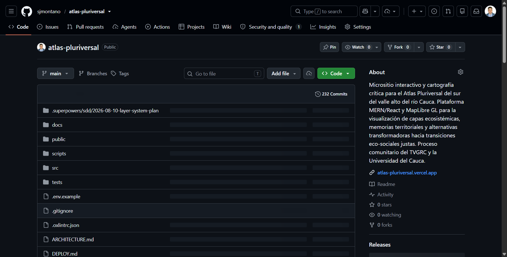

La portada del repositorio muestra **232 commits** en `main`, el enlace del despliegue en
Vercel y la estructura de carpetas del proyecto (`src`, `public`, `docs`, `scripts`).

### 5.2 Historial de `main`

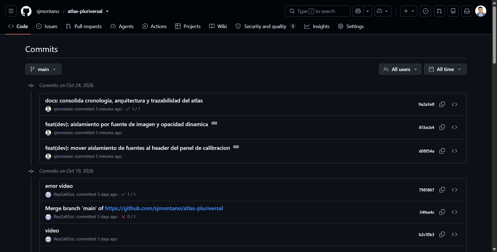

El historial incluye el commit de documentación de esta entrega y los commits de video
incorporados por el colaborador (`b2c10b3` «video», `7981867` «error video»).

### 5.3 Repositorio espejo `atlas-preview`

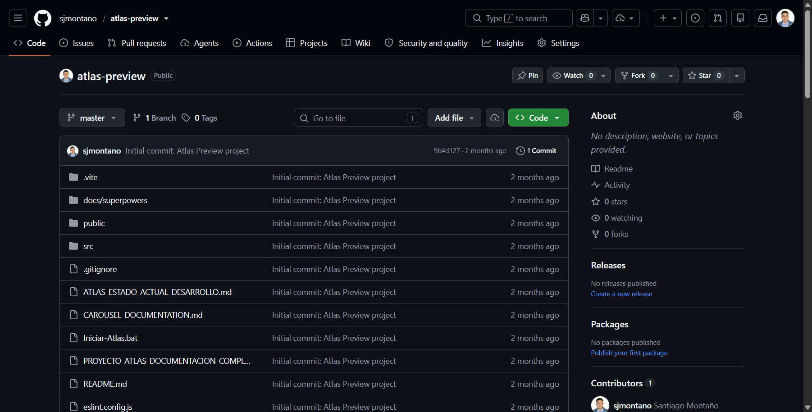

El espejo histórico conserva una sola rama (`master`) y un solo commit visible (`9b4d127`,
«Initial commit: Atlas Preview project»). Es la fuente de la Parte I de esta bitácora.

### 5.4 Línea de tiempo de despliegues (producción)

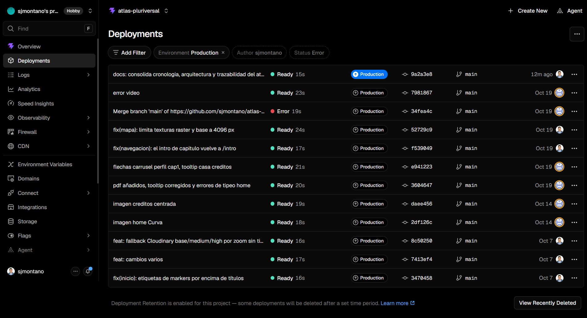

La lista de producción muestra **12 despliegues**, del **7 al 24 de octubre**. El historial
anterior ya no aparece porque el proyecto tiene activada la retención de despliegues; el aviso
al pie lo declara. Por eso Vercel corrobora solo el tramo final: la línea de tiempo completa
sigue siendo `git log` (Partes II y III).

| Fecha en la UI | Commit | Mensaje | Estado | Duración | Autor |
|---|---|---|---|---|---|
| 24m ago | `9a2a3e8` | docs: consolida cronologia, arquitectura y trazabilidad del atlas | Ready | 15s | sjmontano |
| Oct 19 | `7981867` | error video | Ready | 23s | ReyGaRGoL |
| Oct 19 | `34fea4c` | Merge branch 'main' of https://github.com/sjmontano/atlas-pluriversal | Error | 19s | ReyGaRGoL |
| Oct 19 | `52729c9` | fix(mapa): limita texturas raster y base a 4096 px | Ready | 24s | sjmontano |
| Oct 19 | `f539049` | fix(navegacion): el intro de capitulo vuelve a /intro | Ready | 17s | sjmontano |
| Oct 19 | `e941223` | flechas carrusel perfil cap1, tooltip casa creditos | Ready | 21s | ReyGaRGoL |
| Oct 19 | `3604647` | pdf añadidos, tooltip corregidos y errores de tipeo home | Ready | 20s | ReyGaRGoL |
| Oct 14 | `daee456` | imagen creditos centrada | Ready | 19s | ReyGaRGoL |
| Oct 14 | `2df126c` | imagen home Curva | Ready | 18s | ReyGaRGoL |
| Oct 7 | `8c50250` | feat: fallback Cloudinary base/medium/high por zoom sin tiles | Ready | 16s | sjmontano |
| Oct 7 | `7413ef4` | feat: cambios varios | Ready | 17s | sjmontano |
| Oct 7 | `3470458` | fix(inicio): etiquetas de markers por encima de títulos | Ready | 16s | sjmontano |

Resultado del tramo: **11 despliegues en Ready y 1 en Error**. El único fallo es el merge
`34fea4c`; el commit siguiente (`7981867`) volvió a compilar.

### 5.5 Detalle de los despliegues

**Documentación (commit actual de `main`).** Estado Ready, duración 15s, entorno Production
marcado como *Current*, dominios `atlas-pluriversal.vercel.app` y dos alias de Vercel, origen
`main` en `9a2a3e8`.

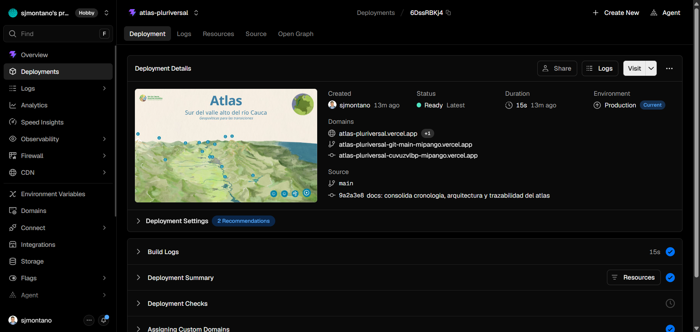

**Video del colaborador.** Estado Ready, 23s, creado el 19 de octubre por `ReyGaRGoL`, origen
`main` en `7981867` («error video»). Es el despliegue que siguió al merge fallido.

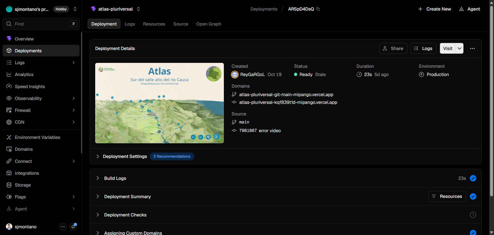

**Merge fallido.** El despliegue de `34fea4c` quedó en Error y *Stale*. El mensaje literal es
`Build Failed` y `Command "pnpm run build" exited with 2`. No hay registro de que ese build
haya reemplazado a producción: el despliegue marcado *Current* es el posterior.

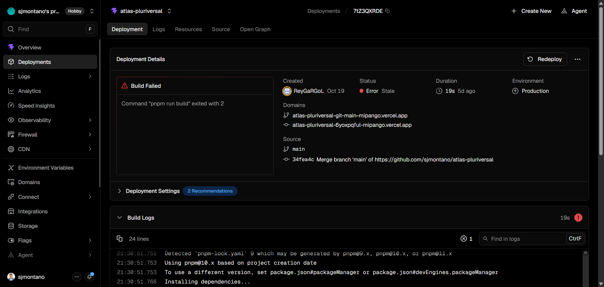

### 5.6 Sitio publicado

Portada:

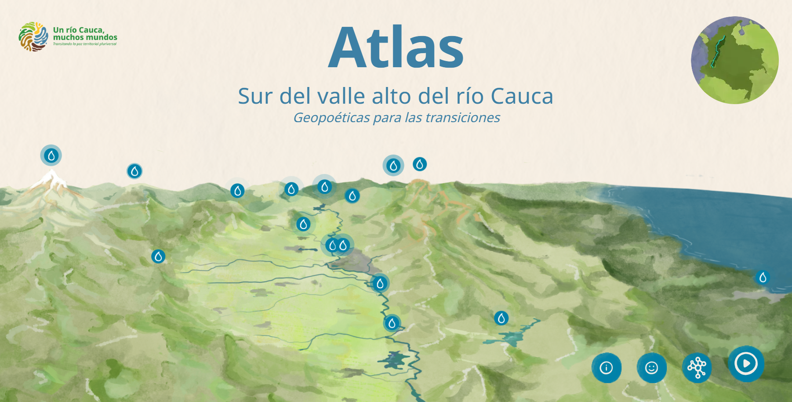

Introducción general y entradas de capítulo:

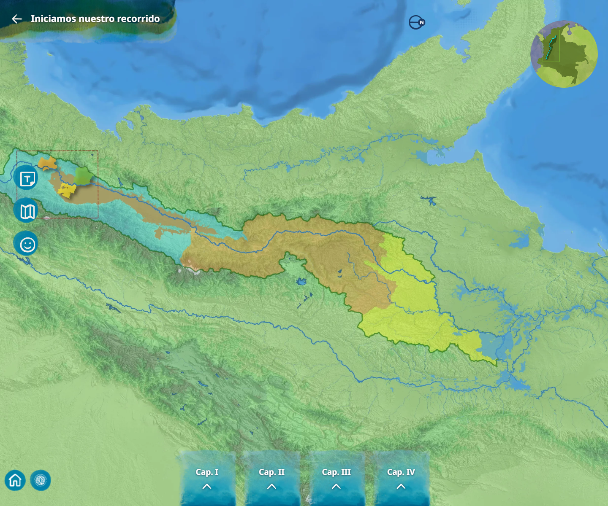

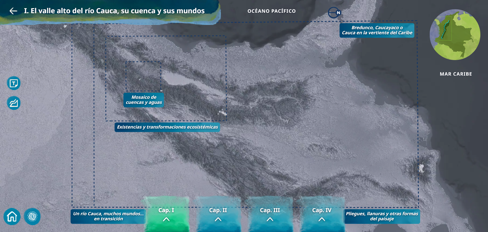

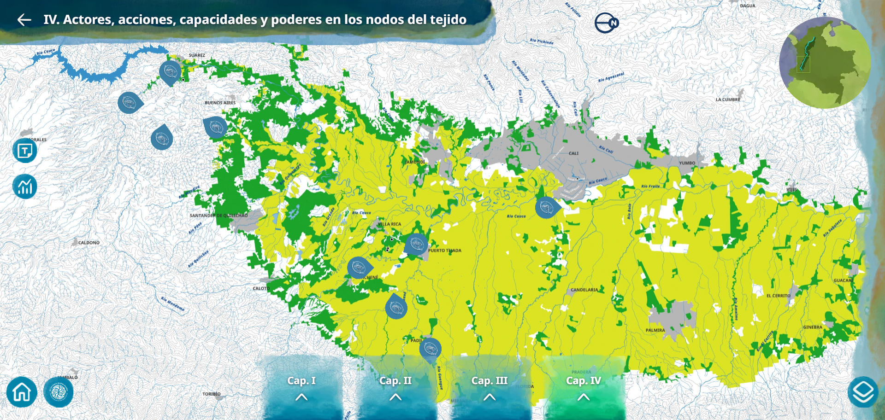

Mapa, modal de contenido y páginas institucionales:

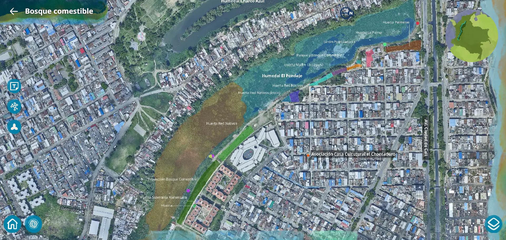

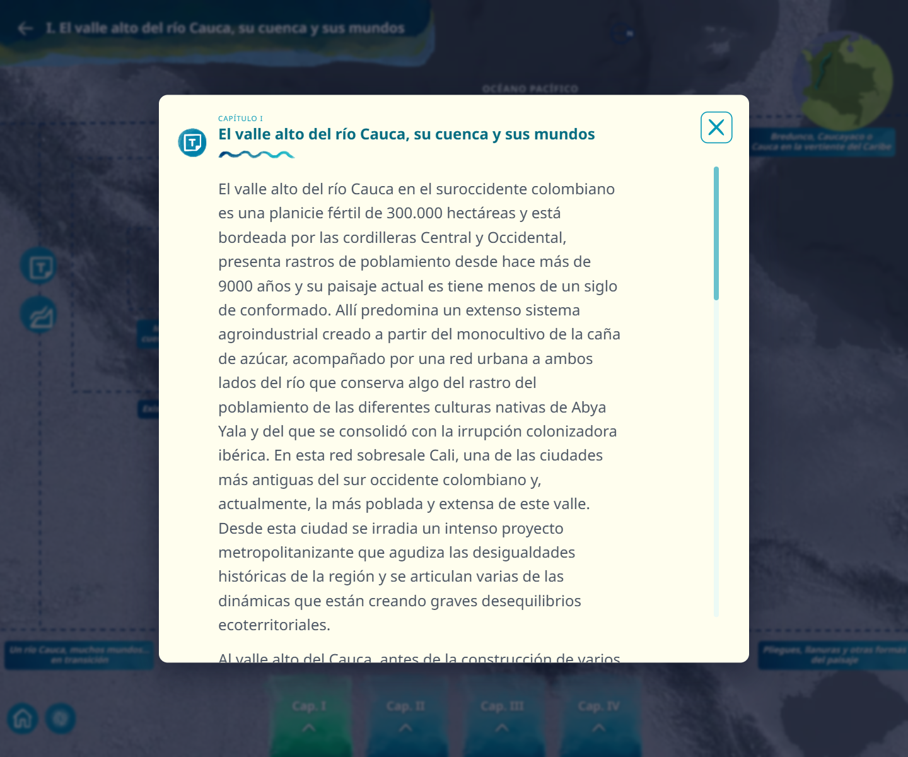

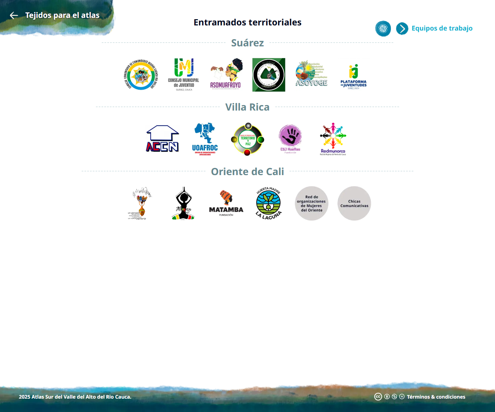

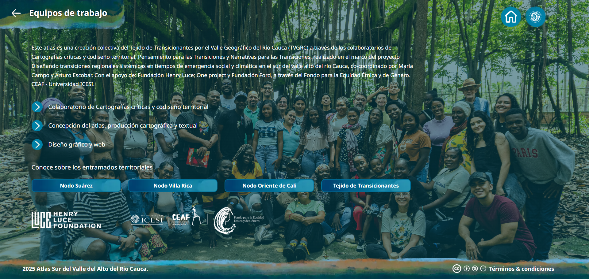

El mapa de `/capitulo/1/chapter1-encuadres` confirma que MapLibre renderiza en producción, no
solo en desarrollo local:

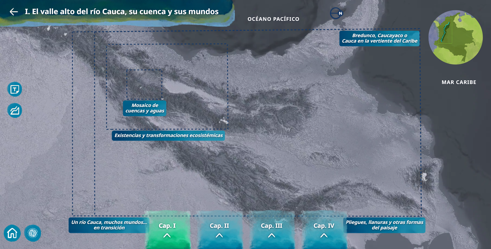

### 5.7 Versión móvil

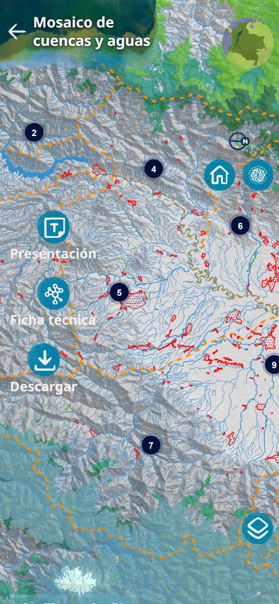

Vista a 390 × 844 px: título, globo de localización, controles de presentación, ficha técnica y
descarga, marcadores numerados y selector de capas. La barra inferior de capítulos no aparece
en esta captura porque queda fuera del alto visible.

### 5.8 El repositorio después del corte

El corte de la Parte III cierra el **2026-10-19** con `main` en `bcaf692` y **228 commits** en
esa rama. Desde entonces:

| Cambio | Commits |
|---|---|
| Trabajo del colaborador sobre video | `b2c10b3`, `7981867` y el merge `34fea4c` |
| Documentación consolidada de esta entrega | `9a2a3e8` |

Eso explica los **232 commits** que muestra GitHub: 228 del corte + 3 del colaborador + 1 de
documentación. El conteo de **238** citado en la Parte III es de `git rev-list --all` (todas
las ramas) al 2026-10-19, por lo que no es comparable con el número de `main`. La
reconstrucción diaria de esta bitácora se detiene en el corte; la Parte V solo documenta el
estado posterior con evidencia visual.
